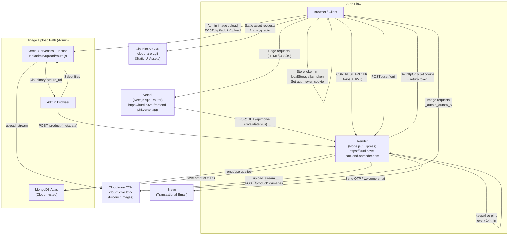

# Kurti Cove — Project Documentation

> **Living reference document.** Based exclusively on direct codebase inspection (December 2024).  
> No secret values are included. All credentials are documented by name and purpose only.  
> A new developer should be able to understand the entire project without reading source code.

---

## Table of Contents

1. [Project Overview](#1-project-overview)
2. [Complete Folder & File Structure](#2-complete-folder--file-structure)
3. [Frontend Documentation](#3-frontend-documentation)
4. [Backend Documentation](#4-backend-documentation)
5. [Database Documentation](#5-database-documentation)
6. [Complete Product Image Pipeline](#6-complete-product-image-pipeline)
7. [API Reference](#7-api-reference)
8. [Environment Variables](#8-environment-variables)
9. [Deployment Architecture](#9-deployment-architecture)
10. [Existing Problems & Technical Debt](#10-existing-problems--technical-debt)
11. [Security Audit](#11-security-audit)
12. [Local Setup & Troubleshooting](#12-local-setup--troubleshooting)
13. [Architecture Diagram](#13-architecture-diagram)
14. [Performance Baseline & Optimization Roadmap](#14-performance-baseline--optimization-roadmap)
15. [Future Maintenance Guide](#15-future-maintenance-guide)

---

## 1. Project Overview

### Project Name & Purpose

**Kurti Cove** is an Indian e-commerce website specializing in women's kurti apparel. It supports product browsing, category filtering, cart management, checkout, order tracking, and a festival sale system. An admin panel handles product, order, review, and sale management.

The site currently has **66 active products** across **8 categories**: co-ord, embroidered, printed, short, cotton, festive, rayon, and long.

### Current Architecture

The project follows a **decoupled frontend/backend architecture**:

- A **Next.js frontend** (App Router, JavaScript/JSX) deployed on Vercel handles all user-facing rendering and admin UI.
- A **Node.js/Express backend** deployed on Render exposes a REST API consumed by the frontend.
- **MongoDB Atlas** (cloud-hosted) stores all application data.
- **Cloudinary** (two separate cloud accounts) stores all images — product images on one account, static UI assets on another.
- **Brevo** (formerly Sendinblue) handles transactional email (OTP, welcome messages).

### Exact Technology Stack

#### Backend
| Concern | Value |
|---|---|
| Runtime | Node.js ≥ 18, ESM (`"type": "module"`) |
| Framework | Express (latest, no pinned version) |
| Database ORM | Mongoose (latest) |
| Database | MongoDB Atlas (cloud-hosted) |
| Image storage | Cloudinary v2 SDK (`cloudinary: latest`) |
| File upload (memory) | Multer (latest, `memoryStorage`) |
| Auth tokens | `jsonwebtoken` (latest), 30-day expiry |
| Password encryption | `cryptr` (symmetric, **NOT bcrypt**) |
| Email | Brevo via `@getbrevo/brevo` v6.1.0 |
| In-memory cache | Plain `Map` (custom TTL logic in `utils/cache.js`; `node-cache` v5.1.2 is installed but unused) |
| Cookie handling | `cookie-parser` (latest) |
| CORS | `cors` (latest) |
| Environment | `dotenv` (latest) |
| Dev hot-reload | `nodemon` (latest) |
| Compression | **NOT installed** — `compression` package is absent |

#### Frontend
| Concern | Value |
|---|---|
| Framework | Next.js (latest, 15/16 series — confirmed by `turbopack: {}` config) |
| Language | JavaScript/JSX (no TypeScript) |
| Styling | Tailwind CSS (latest) + heavy inline styles |
| State management | Redux Toolkit (`@reduxjs/toolkit` latest) + `react-redux` latest |
| HTTP client | Axios (latest) via `src/utils/Helper.js` |
| Icons | `lucide-react` v1.28.0, `react-icons` (latest) |
| Toast notifications | `react-hot-toast` (latest) |
| Image optimization | Next.js `<Image>` component **not used** for product images — raw `` tags used; Cloudinary URL transforms via `cldUrl()` |
| Image processing | `sharp` v0.35.4 (dev, used by Next.js image optimization pipeline) |
| HTML sanitization | `dompurify` v3.4.14 (product descriptions rendered with DOMPurify) |
| Fonts | `next/font/google`: Playfair Display, Poppins, Dancing Script |
| Cloudinary SDK | `cloudinary` v2.11.0 (used in Next.js API route for admin upload only) |
| Package manager | npm |
| Build | `next build` / `next dev` / `next start` |

### Hosting

| Service | URL |
|---|---|
| Frontend (Vercel) | https://kurti-cove-frontend-phi.vercel.app |
| Backend (Render) | https://kurti-cove-backend.onrender.com |

### Database & External Services

| Service | Purpose |
|---|---|
| MongoDB Atlas | Primary data store: products, users, orders, cart, reviews, sales |
| Cloudinary (cloud: `chxubhiv`) | Product image storage and CDN delivery |
| Cloudinary (cloud: `arerzgij`) | Static UI asset storage (hero images, category tiles, store photos, payment icons) |
| Brevo | Transactional email: OTP verification, welcome emails |

### Current Implementation Status

| Feature | Status |
|---|---|
| Product listing, filtering, sorting, pagination | Implemented |
| Product detail page | Implemented (CSR only — no SSR/SSG) |
| Cart (localStorage + DB sync) | Implemented |
| Checkout (COD + UPI/PhonePe/GPay) | Implemented |
| Order management | Implemented |
| User registration with OTP | Implemented |
| User login/logout | Implemented |
| Admin panel (products, orders, reviews, sales) | Implemented |
| Festival sale countdown | Implemented |
| Wishlist | Implemented (localStorage only, no server sync) |
| Payment gateway integration | Not implemented (UPI deep-link only; no payment verification) |
| Full-text search | Implemented (MongoDB text index) |
| Image optimization (responsive `srcset`) | Not implemented (manual Cloudinary URL transforms only) |
| HTTP response compression | Not implemented |
| Rate limiting | Not implemented |
| Server-side rendering for Shop / PDP | Not implemented |

---

## 2. Complete Folder & File Structure

### Backend (`backend/`)

```
backend/
├── server.js                   ← Entry point: Express app, DB connect, middleware, route mounting
├── package.json                ← ESM module, Node ≥18, no version pinning
├── .env.example                ← Variable names only (no values); use as template for .env
├── .gitignore
├── controllers/
│   ├── CartController.js       ← sync, add, remove, update qty, clear cart
│   ├── OrderController.js      ← place order, my-orders, stats, by-id, cancel, admin CRUD
│   ├── ProductController.js    ← list/filter/search, getById, create/update/delete,
│   │                              uploadImages, getHomeData, getSimilarProducts, getCategories
│   ├── ReviewController.js     ← get by product, create/update/delete (admin), markHelpful
│   ├── SaleController.js       ← festival sale CRUD + toggle active
│   └── UserController.js       ← register, OTP verify/resend, login, adminLogin, logout,
│                                  getMe, updateProfile, changePassword, addAddress, deleteAddress
├── middleware/
│   └── auth.js                 ← protect() (JWT verify + DB user fetch) + authorize() (role check)
├── models/
│   ├── CartModel.js            ← userId (ref User), items [{productId, qty}]
│   ├── OrderModel.js           ← user, items snapshot, address snapshot, pricing, payment/order status
│   ├── ProductModel.js         ← full product schema + 7 compound indexes + text index
│   ├── ReviewModel.js          ← productId, customerName, rating, comment, imageUrl, helpfulCount
│   ├── SaleModel.js            ← title, isActive, startTime, endTime, products [{productId, salePrice}]
│   └── UserModel.js            ← name, email, password (Cryptr), role, OTP, addresses[]
├── routes/
│   ├── CartRoutes.js           ← Mounts cart endpoints
│   ├── OrderRoutes.js          ← Mounts order endpoints
│   ├── ProductRoutes.js        ← Mounts product endpoints
│   ├── ReviewRoutes.js         ← Mounts review endpoints
│   ├── SaleRoutes.js           ← Mounts sale endpoints
│   └── UserRoutes.js           ← Mounts user/auth endpoints
├── services/
│   └── emailService.js         ← Brevo SDK wrappers: sendEmail(), sendOTPEmail(), sendWelcomeEmail()
└── utils/
    ├── cache.js                ← Plain Map-based TTL cache: getCache, setCache, deleteCache,
    │                              clearCacheByPrefix, clearAllCache
    ├── cloudinary.js           ← Lazy Cloudinary v2 config loaded from env vars
    ├── generateToken.js        ← JWT sign with userId payload, 30-day expiry
    ├── keepAlive.js            ← Self-ping every 14 min in production (prevents Render sleep)
    ├── multer.js               ← Memory storage, 10 MB limit per file, image/* MIME filter
    ├── seedAdmin.js            ← Creates superAdmin on startup if ADMIN_EMAIL user does not exist
    ├── SendOtpMail.js          ← Calls emailService.sendOTPEmail(); also logs OTP to console
    └── uploadToCloudinary.js   ← Buffer → Cloudinary upload_stream; returns secure_url string
```

### Frontend (`frontend/`)

```
frontend/
├── package.json                ← npm, Next.js deps, no TypeScript
├── next.config.mjs             ← Next.js config (Turbopack enabled)
├── tailwind.config.js          ← Tailwind configuration
├── .env.example                ← Frontend env var names only
├── .gitignore
├── cloudinary-urls.json        ← Map of 52 static UI asset paths → Cloudinary URLs (cloud: arerzgij)
└── src/
    ├── API/
    │   └── serverAPI.js        ← Server-side API helper (used by Server Components / API routes)
    ├── proxy.js                ← Dev proxy configuration
    ├── app/
    │   ├── globals.css         ← Tailwind base directives + global CSS resets
    │   ├── layout.jsx          ← Root layout: Google fonts, Redux provider, Header, Footer,
    │   │                          Preloader, react-hot-toast Toaster
    │   ├── page.jsx            ← HOME — Server Component, ISR revalidate: 90s, fetches /api/home
    │   ├── admin/
    │   │   ├── layout.jsx      ← AdminGuard wrapper; hides public Header/Footer
    │   │   ├── page.jsx        ← Admin dashboard overview
    │   │   ├── orders/page.jsx ← Admin order management
    │   │   ├── products/page.jsx← Admin product CRUD with ProductForm modal
    │   │   ├── reviews/page.jsx ← Admin review management
    │   │   └── sale/page.jsx   ← Festival sale management
    │   ├── api/
    │   │   └── admin/upload/route.js ← Next.js API route: POST multipart → Cloudinary
    │   │                              (server-side, Cloudinary credentials never reach browser)
    │   ├── cart/page.jsx       ← Cart page (CSR, Redux store)
    │   ├── checkout/page.jsx   ← Checkout: address selection, UPI/PhonePe/GPay, order placement
    │   ├── contact/page.jsx    ← Contact page (static)
    │   ├── login/page.jsx      ← Login (CSR, Suspense-wrapped)
    │   ├── orders/
    │   │   ├── page.jsx        ← User order list (CSR)
    │   │   └── [id]/page.jsx   ← Order detail (CSR)
    │   ├── product/
    │   │   └── [id]/page.jsx   ← Product Detail Page (CSR — no SSR/ISR; performance gap)
    │   ├── profile/page.jsx    ← User profile
    │   ├── register/page.jsx   ← Registration form
    │   ├── shop/page.jsx       ← Shop: full filter/sort/pagination, URL-driven state (CSR)
    │   ├── thank-you/[id]/page.jsx ← Post-order confirmation
    │   ├── verify-otp/page.jsx ← OTP verification
    │   └── wishlist/page.jsx   ← Wishlist (localStorage-only)
    ├── components/
    │   ├── admin/
    │   │   ├── AdminGuard.jsx  ← Calls GET /user/get; redirects if role ≠ admin/superAdmin
    │   │   ├── AdminSidebar.jsx← Admin navigation sidebar
    │   │   ├── OrderTable.jsx  ← Admin order display and status management
    │   │   └── ProductForm.jsx ← Create/edit product modal with image upload
    │   └── user/
    │       ├── BestSellers.jsx ← Best sellers product carousel section
    │       ├── CategoryGrid.jsx← 9 category tiles using staticImg()
    │       ├── Combos.jsx      ← Combos section; accepts initialData prop from SSR home
    │       ├── CustomerReviews.jsx ← Customer review section
    │       ├── FeaturedProducts.jsx← Featured products section
    │       ├── FestivalSale.jsx← Festival sale countdown/banner
    │       ├── FestiveLooks.jsx← Editorial looks grid
    │       ├── Footer.jsx      ← Site footer with links and contact info
    │       ├── Header.jsx      ← Sticky nav: logo, search, cart badge, wishlist, user menu,
    │       │                      mobile drawer with categories
    │       ├── HeroBanner.jsx  ← Full-width hero slider (desktop + mobile image variants)
    │       ├── NewsletterBanner.jsx ← Newsletter signup banner
    │       ├── NewArrivals.jsx ← New arrivals product carousel
    │       ├── Preloader.jsx   ← Full-screen overlay on first visit
    │       ├── ProductCard.jsx ← Reusable card: image (w_480, lazy), price, discount %, sizes, wishlist
    │       ├── ProductReviews.jsx ← Product review display section
    │       ├── SimilarProducts.jsx ← Similar products carousel on PDP
    │       └── VisitOurStores.jsx  ← Physical store locations with images
    ├── lib/
    │   ├── cloudinaryImage.js  ← cldUrl() (injects f_auto,q_auto transforms),
    │   │                          normalizeProductImages(), getProductImageSrc()
    │   └── staticImg.js        ← Static asset → Cloudinary URL lookup map + cldUrl() transforms
    ├── redux/
    │   ├── ReduxProvider.jsx   ← StoreProvider wrapper for Next.js App Router
    │   ├── store.js            ← configureStore; single reducer: cart
    │   └── features/
    │       └── CartSlice.js    ← addtocart, emptycart, lstoCart, qtyChange, removeItem,
    │                              resetCart, loadUserCart
    └── utils/
        ├── cartHelper.js       ← syncAndLoadCart(), addToCartWithSync(), removeFromCartSync()
        ├── Helper.js           ← Axios instance: baseURL=NEXT_PUBLIC_API_BASE_URL,
        │                          JWT interceptor (reads kc_token from localStorage), 401 redirect
        └── homeDataCache.js    ← Client-side 90s TTL cache + in-flight deduplication for /api/home
```

### Generated / Build Output / Do Not Commit

| Path | Reason |
|---|---|
| `frontend/.next/` | Next.js build output — generated by `next build` |
| `frontend/node_modules/` | npm dependencies |
| `backend/node_modules/` | npm dependencies |
| `frontend/.env.local` | Local secrets for frontend |
| `backend/.env` | Local secrets for backend |
| Any `*.log` files | Runtime logs |

---

## 3. Frontend Documentation

### Framework & Rendering

**Framework:** Next.js (App Router, 15/16 series, JavaScript/JSX, no TypeScript)  
**Package manager:** npm  
**Styling:** Tailwind CSS + inline styles  
**Fonts:** Playfair Display, Poppins, Dancing Script (loaded via `next/font/google` in `app/layout.jsx`)

### Rendering Strategy Per Page

| Page | Route | Strategy | Data Source |
|---|---|---|---|
| Home | `/` | **ISR** (Server Component, revalidate: 90s) | `fetch('/api/home')` at build/request time |
| Shop | `/shop` | **CSR** (`'use client'`) | `fetch('/api/product?...')` on each filter/page change |
| Product Detail | `/product/[id]` | **CSR** (`'use client'`) | `fetch('/api/product/:id')` on mount (no SSR — performance gap) |
| Checkout | `/checkout` | **CSR** | API calls on mount (user addresses); requires auth |
| Login | `/login` | **CSR** (Suspense-wrapped) | API call on submit |
| Register | `/register` | **CSR** | API call on submit |
| Verify OTP | `/verify-otp` | **CSR** | API call on submit |
| Orders | `/orders` | **CSR** | `GET /api/order/my-orders` |
| Order Detail | `/orders/[id]` | **CSR** | `GET /api/order/:id` |
| Profile | `/profile` | **CSR** | `GET /api/user/get` |
| Cart | `/cart` | **CSR** | Redux store (localStorage) — no API needed |
| Wishlist | `/wishlist` | **CSR** | localStorage only |
| Contact | `/contact` | CSR | Static |
| Thank You | `/thank-you/[id]` | **CSR** | Order data from query params |
| Admin pages | `/admin/**` | **CSR** (AdminGuard) | Various admin API endpoints |

### Application Entry Points

- **Root layout:** `src/app/layout.jsx` — wraps entire app in Redux provider, injects fonts, renders `<Header>`, `<Footer>`, `<Preloader>`, and react-hot-toast `<Toaster>`.
- **Home page:** `src/app/page.jsx` — only Server Component in the project; fetches aggregated home data with ISR.
- **HTTP client:** `src/utils/Helper.js` — Axios instance with `baseURL` from `NEXT_PUBLIC_API_BASE_URL`; automatically injects JWT from `localStorage.kc_token` on every request; redirects to `/login` on 401.

### Key Pages

#### Home Page (`app/page.jsx`)
Server Component with `revalidate: 90` ISR. Fetches `GET /api/home` and renders all homepage sections as components. Passes `initialData` to `<Combos>` to avoid a duplicate client-side fetch. Sections rendered: `<HeroBanner>`, `<CategoryGrid>`, `<NewArrivals>`, `<BestSellers>`, `<FeaturedProducts>`, `<Combos>`, `<FestivalSale>`, `<FestiveLooks>`, `<CustomerReviews>`, `<VisitOurStores>`, `<NewsletterBanner>`.

#### Shop Page (`app/shop/page.jsx`)
Fully CSR. URL query params are the single source of truth for all filter state (`category`, `search`, `sort`, `size`, price range, page number). On any filter change, updates the URL and fires a new `GET /api/product?...` call with `cache: 'no-store'`. Renders a grid of `<ProductCard>` components with pagination controls.

#### Product Detail Page (`app/product/[id]/page.jsx`)
Fully CSR. Fetches `GET /api/product/:id` on mount. Fetches `GET /api/review?productId=:id` separately. Shows image gallery (w_1000 desktop, w_800 mobile; first 2 images eager, rest lazy), description (rendered via DOMPurify), size/color selectors, add-to-cart. Renders `<SimilarProducts>` which makes a third API call.

#### Cart Page (`app/cart/page.jsx`)
Reads entirely from Redux store (which mirrors `localStorage.kc_cart`). Calls `syncAndLoadCart()` on mount if user is logged in, which syncs the DB cart via `POST /api/cart/sync`. No page-level API call otherwise.

#### Checkout Page (`app/checkout/page.jsx`)
Fetches user addresses on mount via `GET /api/user/get`. Allows address selection or new address entry. Payment options: COD, UPI, PhonePe, Google Pay. On submit calls `POST /api/order/place`. UPI options use `NEXT_PUBLIC_STORE_UPI_ID` to generate a UPI deep-link.

### Key Components

#### `ProductCard` (`components/user/ProductCard.jsx`)
The primary reusable product display unit. Receives a product object. Calls `normalizeProductImages()` to get the first image, then `cldUrl(src, { width: 480 })` to inject Cloudinary transforms. Uses `` (or `eager` for above-fold cards). Shows name, price, discount percentage, size badges, and a wishlist toggle. On image load error, tries the raw URL once, then falls back to a `👗` emoji placeholder.

#### `Header` (`components/user/Header.jsx`)
Sticky navigation. Shows logo, inline search bar, cart badge (Redux cart item count), wishlist count (localStorage), and user menu (login/register or profile/logout). On mobile, shows a hamburger drawer with category links. The search bar triggers navigation to `/shop?search=<query>`.

#### `AdminGuard` (`components/admin/AdminGuard.jsx`)
Client-side auth check that runs on every admin page mount. Calls `GET /api/user/get`; if the response role is not `admin` or `superAdmin`, redirects to `/login?error=unauthorized`. Admin layout wraps every admin page in this component and also hides the public `<Header>` and `<Footer>`.

#### `ProductForm` (`components/admin/ProductForm.jsx`)
Modal for creating and editing products. On image selection, sends files to `POST /api/admin/upload` (the Next.js API route), which uploads to Cloudinary server-side. Product metadata (name, category, price, flags, etc.) is submitted to `POST /api/product` (create) or `PUT /api/product/:id` (update) on the Express backend.

### State Management

Redux Toolkit is used exclusively for cart state. There is no React Context API, no Zustand, and no server state library (React Query, SWR).

**Cart slice actions (`CartSlice.js`):**
- `addtocart(product)` — add item or increment quantity; persists to `localStorage.kc_cart`
- `emptycart()` — clear all; removes from localStorage
- `lstoCart()` — load from `localStorage.kc_cart` on mount
- `qtyChange({ id, flag })` — increment or decrement; removes item if quantity reaches 0
- `removeItem({ id })` — remove specific item
- `resetCart()` — called on logout
- `loadUserCart(dbItems)` — replace cart with DB-synced data after login

**Client-side persistence keys:**
| Key | Storage | Data |
|---|---|---|
| `kc_cart` | localStorage | Cart items array |
| `kc_token` | localStorage | JWT token |
| `kc_user` | localStorage | User profile object |
| `auth_token` | document.cookie | JWT (non-httpOnly, for SSR middleware) |
| `kc_wishlist` | localStorage | Wishlisted product IDs |

**Auth state** is not in Redux. Auth is checked on-demand via API calls or localStorage reads. `Helper.js` reads `kc_token` from localStorage and injects it into every Axios request.

### Loading & Error States

- Most CSR pages show a full-page spinner while awaiting API responses.
- No `loading.js` files or per-section `<Suspense>` boundaries are implemented — this is a confirmed performance gap.
- `react-hot-toast` is used for success/error feedback on user actions.
- `ProductCard` handles broken images with an `onError` fallback.
- DOMPurify sanitizes HTML in product descriptions before rendering.

### Responsive Design

Tailwind CSS is the primary responsive tool. The `HeroBanner` component loads different image URLs for desktop and mobile. `ProductCard` layouts adapt across breakpoints via Tailwind utility classes. The `Header` collapses into a hamburger drawer on mobile.

---

## 4. Backend Documentation

### Server Entry Point (`server.js`)

Startup sequence:
1. Load `dotenv` config.
2. Create Express app.
3. Apply middleware: `cookie-parser`, `express.json()`, `express.urlencoded()`, CORS (see Section 11 for origins).
4. Mount route files under `/api/` prefix.
5. Register inline health check routes (`GET /` and `GET /api/health`).
6. Connect to MongoDB Atlas via `mongoose.connect(MONGODB_URI)`.
7. In `.then()` callback: call `seedAdmin()` and call `startKeepAlive()`.
8. Listen on `process.env.PORT` (default 5000).

**No compression middleware.** All responses are uncompressed.

### Route Files

| File | Mounted at |
|---|---|
| `routes/UserRoutes.js` | `/api/user` |
| `routes/ProductRoutes.js` | `/api/product` |
| `routes/CartRoutes.js` | `/api/cart` |
| `routes/OrderRoutes.js` | `/api/order` |
| `routes/SaleRoutes.js` | `/api/sale` |
| `routes/ReviewRoutes.js` | `/api/review` |

### Middleware (`middleware/auth.js`)

- **`protect`** — Extracts JWT from `req.cookies.jwt` or `Authorization: Bearer <token>` header. Verifies with `SECRET_KEY`. Fetches full user from MongoDB and attaches to `req.user`. Rejects with 401 if token is missing, invalid, or user not found.
- **`authorize(...roles)`** — Checks `req.user.role` against the allowed roles array. Rejects with 403 if role does not match.

### Controller Functions

#### UserController.js

| Function | Method | Path | Auth | Description |
|---|---|---|---|---|
| `registerUser` | POST | `/api/user/create` | Public | Encrypts password with Cryptr; generates 6-digit OTP (10 min); saves user as `isVerified: false`; sends OTP email via Brevo |
| `verifyOtp` | POST | `/api/user/verify-otp` | Public | Verifies OTP and expiry; sets `isVerified: true`; clears OTP; sets JWT httpOnly cookie; sends welcome email; returns token + user |
| `resendOtp` | POST | `/api/user/reset-otp` | Public | Regenerates OTP; resends email |
| `loginUser` | POST | `/api/user/login` | Public | Validates email+password; checks `isVerified`; sets JWT httpOnly cookie (30 days) |
| `adminLogin` | POST | `/api/user/admin-login` | Public | Same as login but only succeeds for `admin` or `superAdmin` roles |
| `logoutUser` | POST | `/api/user/logout` | Public | Clears `jwt` cookie |
| `getMe` | GET | `/api/user/get` | Protected | Returns current user object (excludes `password` and `otp`) |
| `updateProfile` | PUT | `/api/user/update-profile` | Protected | Updates `name` and `mobile` |
| `changePassword` | PATCH | `/api/user/change-password` | Protected | Requires current password; validates via Cryptr decrypt + compare |
| `addAddress` | POST | `/api/user/addaddresses` | Protected | Appends address sub-document to `addresses[]` |
| `deleteAddress` | PUT | `/api/user/deleteaddress` | Protected | Removes address by array index |

#### ProductController.js

| Function | Method | Path | Auth | Description |
|---|---|---|---|---|
| `getProducts` | GET | `/api/product` | Public | Filter by category, search (text index), size, boolean flags, price range, discount. Paginated (default 20). Cached 60s with params-based key. |
| `getCategories` | GET | `/api/product/categories` | Public | Distinct categories with product counts. Cached 120s. |
| `getSimilarProducts` | GET | `/api/product/similar` | Public | Matches by category + boolean flags for `?productId=`. Cached 120s. |
| `getProductById` | GET | `/api/product/:id` | Public | Full product. Cached 120s. |
| `createProduct` | POST | `/api/product` | Admin | Creates product (images not included — added via upload endpoint). Invalidates all product cache. |
| `updateProduct` | PUT | `/api/product/:id` | Admin | Updates fields. Invalidates all product cache. |
| `deleteProduct` | DELETE | `/api/product/:id` | Admin | Deletes product. Invalidates all product cache. |
| `uploadProductImages` | POST | `/api/product/:id/images` | Admin | Multer `upload.array('images', 10)` → concurrent Cloudinary uploads → appends `secure_url` strings to `product.images[]`. Invalidates cache. |
| `getHomeData` | GET | `/api/home` | Public | Aggregated: newArrivals(8), bestSellers(8), combos(8), deals60(4, ≥60% off), categories. Runs 5 queries concurrently via `Promise.all`. Cached 90s. |

#### CartController.js

| Function | Method | Path | Auth | Description |
|---|---|---|---|---|
| `syncCart` | POST | `/api/cart/sync` | Protected | Merges localStorage cart with DB cart on login |
| `addToCart` | POST | `/api/cart/add_to_cart` | Protected | Adds item or increments quantity |
| `removeFromCart` | DELETE | `/api/cart/remove` | Protected | Removes item by `productId` (sent in request body) |
| `updateCartItem` | PUT | `/api/cart/update` | Protected | Updates quantity for a specific item |
| `clearCart` | DELETE | `/api/cart/clear` | Protected | Removes all items from user's cart |

#### OrderController.js

| Function | Method | Path | Auth | Description |
|---|---|---|---|---|
| `placeOrder` | POST | `/api/order/place` | Protected | Reads DB cart; calculates subtotal + delivery (₹49 if subtotal < ₹300, else free); saves order snapshot; clears cart |
| `getMyOrders` | GET | `/api/order/my-orders` | Protected | All orders for current user, sorted newest first |
| `getOrderStats` | GET | `/api/order/stats` | Protected | Total order count and total amount spent by user |
| `getOrderById` | GET | `/api/order/:id` | Protected | Single order; ownership enforced (admin bypasses) |
| `cancelOrder` | PATCH | `/api/order/cancel/:id` | Protected | Cancels only if `orderStatus === 'placed'` |
| `getAllOrders` | GET | `/api/order/admin/all` | Admin | Paginated all orders; searchable by ObjectId |
| `updateOrderStatus` | PATCH | `/api/order/admin/status/:id` | Admin | Status progression: placed → confirmed → shipped → out_for_delivery → delivered/cancelled |

#### SaleController.js

| Function | Method | Path | Auth | Description |
|---|---|---|---|---|
| `getActiveSale` | GET | `/api/sale/active` | Public | Returns active sale with `secondsRemaining`; returns `null` if none active |
| `getAllSales` | GET | `/api/sale/all` | Admin | All sales with populated product details |
| `createSale` | POST | `/api/sale/create` | Admin | Creates sale; deactivates all others if `isActive: true` |
| `updateSale` | PUT | `/api/sale/update/:id` | Admin | Updates sale fields |
| `deleteSale` | DELETE | `/api/sale/delete/:id` | Admin | Deletes sale |
| `toggleSaleStatus` | PATCH | `/api/sale/toggle/:id` | Admin | Toggles active/inactive; enforces single-active constraint |

#### ReviewController.js

| Function | Method | Path | Auth | Description |
|---|---|---|---|---|
| `getReviewsByProduct` | GET | `/api/review` | Public | `?productId=` — all reviews sorted newest first |
| `markHelpful` | POST | `/api/review/:id/helpful` | Public | Increments `helpfulCount` |
| `getAllReviews` | GET | `/api/review/all` | Admin | All reviews with populated product |
| `createReview` | POST | `/api/review` | Admin | Creates review with optional image upload |
| `updateReview` | PATCH | `/api/review/:id` | Admin | Updates review with optional image re-upload |
| `deleteReview` | DELETE | `/api/review/:id` | Admin | Deletes review |

### keepAlive.js

**File:** `backend/utils/keepAlive.js`

- **Purpose:** Prevents Render free tier from spinning down (Render sleeps a service after ~15 min of no inbound traffic).
- **Mechanism:** `setInterval(ping, 14 * 60 * 1000)` — pings its own health endpoint every 14 minutes.
- **Target URL:** `${process.env.RENDER_URL}/api/health`
- **Activation conditions:** `NODE_ENV === 'production'` AND `RENDER_URL` env var is set. If either is missing, the interval is never started.
- **Wired in:** Called inside `mongoose.connect().then()` in `server.js` — only starts if DB connection succeeds.
- **Limitation:** Only works while the Render instance itself is running. Does not prevent the very first cold start when the instance is sleeping.

### cache.js

**File:** `backend/utils/cache.js`

- **Implementation:** A plain JavaScript `Map` (named `store`) — the installed `node-cache` package is **not used**.
- **Default TTL:** 90 seconds.
- **Exports:** `getCache(key)`, `setCache(key, value, ttlSeconds)`, `deleteCache(key)`, `clearCacheByPrefix(prefix)`, `clearAllCache()`.
- **Consumer:** `ProductController.js` only.

| Cache Key Pattern | TTL | Created In | Invalidated When |
|---|---|---|---|
| `home:all` | 90s | `getHomeData()` | Any product write operation |
| `product:list:<params_hash>` | 60s | `getProducts()` | Any product write operation |
| `product:id:<id>` | 120s | `getProductById()` | Any product write operation |
| `product:similar:<id>` | 120s | `getSimilarProducts()` | Any product write operation |
| `categories:all` | 120s | `getCategories()` | Any product write operation |

**Invalidation function:** `invalidateProductCache()` calls `clearCacheByPrefix('product:')` + `clearCacheByPrefix('home:')` + `deleteCache('categories:all')`. Triggered on `createProduct`, `updateProduct`, `deleteProduct`, `uploadProductImages`.

**Important limitation:** The cache is in-process memory. On Render free tier, every cold start wipes the entire cache. If multiple instances ever run, caches are not shared between them.

### Input Validation & Error Handling

- Validation is done inside controller functions (manual checks, no schema validation library such as Joi or Zod).
- Errors are returned as JSON `{ success: false, message: '...' }` with appropriate HTTP status codes.
- `auth.js` returns 401 (unauthorized) and 403 (forbidden) for auth failures.
- No global error handler middleware is registered in `server.js`.

### CORS Configuration

See also Section 11 (Security Audit) for a security assessment.

Allowed origins (from `server.js`):
- `process.env.FRONTEND_URL`
- `process.env.FRONTEND_URL_2` (optional)
- `http://localhost:3000`
- `http://localhost:3001`
- Any URL matching regex `/^https?:\/\/kurti-cove-frontend[^.]*\.vercel\.app$/` (allows Vercel preview deployments)
- Requests with no `Origin` header are allowed (server-to-server, curl, Postman)

`credentials: true` — cookies are sent cross-origin.

---

## 5. Database Documentation

### Provider & Type

**MongoDB Atlas** (fully managed cloud MongoDB). The connection string is provided via `MONGODB_URI` environment variable. No self-hosted MongoDB instance.

### Models & Schemas

#### ProductModel (`products` collection)

| Field | Type | Default | Constraints / Notes |
|---|---|---|---|
| `_id` | ObjectId | auto-generated | Primary key |
| `name` | String | required | Trimmed |
| `description` | String | required | May contain HTML; rendered via DOMPurify on frontend |
| `category` | String | `''` | Trimmed; known values: `co-ord`, `festive`, `cotton`, `printed`, `short`, `embroidered`, `rayon`, `long` |
| `price` | Number | required | Min 0; original/MRP price |
| `discountPrice` | Number | `null` | Min 0; selling price if set; `null` = no discount |
| `images` | [String] | `[]` | Array of Cloudinary `secure_url` strings |
| `colors` | [String] | `[]` | Color options |
| `sizes` | [String] | `[]` | e.g. `['XS','S','M','L','XL','XXL']` |
| `stock` | Number | 0 | Min 0 |
| `isFeatured` | Boolean | false | |
| `isNewArrival` | Boolean | false | |
| `isBestSeller` | Boolean | false | |
| `onSale` | Boolean | false | |
| `createdAt` | Date | auto | Mongoose timestamps |
| `updatedAt` | Date | auto | Mongoose timestamps |

**Indexes:**

| Index | Fields | Purpose |
|---|---|---|
| Text | `{ name: 'text', description: 'text' }` | Full-text search (`$text` queries) |
| Compound | `{ isNewArrival: 1, createdAt: -1 }` | New arrivals query |
| Compound | `{ isBestSeller: 1, createdAt: -1 }` | Best sellers query |
| Compound | `{ isFeatured: 1, createdAt: -1 }` | Featured products query |
| Compound | `{ onSale: 1, createdAt: -1 }` | On-sale products query |
| Compound | `{ category: 1, createdAt: -1 }` | Category filter query |
| Single | `{ createdAt: -1 }` | General sort by newest |

#### UserModel (`users` collection)

| Field | Type | Default | Notes |
|---|---|---|---|
| `name` | String | required | |
| `email` | String | required, unique, lowercase | |
| `password` | String | required | Cryptr-encrypted (reversible symmetric encryption; NOT bcrypt) |
| `mobile` | String | `''` | |
| `role` | String | `'user'` | Enum: `user`, `admin`, `superAdmin` |
| `isVerified` | Boolean | false | Set `true` after OTP verification |
| `otp` | Number | null | 6-digit; nulled after use |
| `otpExpire` | Date | null | 10-minute window |
| `addresses` | [addressSchema] | `[]` | Array of embedded address sub-documents |

**Address sub-schema fields:** `fullName`, `mobile`, `pincode`, `addressLine`, `city`, `state` — all required strings.

#### CartModel (`carts` collection)

| Field | Type | Notes |
|---|---|---|
| `userId` | ObjectId (ref: User) | Unique — one cart per user |
| `items` | [{productId, qty}] | `productId` ref to Product; `qty` min 1; `_id: false` |

#### OrderModel (`orders` collection)

| Field | Type | Notes |
|---|---|---|
| `user` | ObjectId (ref: User) | required |
| `items` | [orderItemSchema] | Snapshot: `productId`, `name`, `price`, `qty`, `image` (first image URL) |
| `address` | addressSchema | Snapshot at order time (not a ref — data is copied) |
| `subtotal` | Number | Sum of item prices × quantities |
| `deliveryCharge` | Number | ₹49 if subtotal < ₹300, else 0 |
| `totalAmount` | Number | `subtotal + deliveryCharge` |
| `paymentMethod` | String | Enum: `cod`, `upi`, `phonepe`, `googlepay` |
| `paymentStatus` | String | Enum: `pending`, `pending_verification`, `paid`, `failed` |
| `orderStatus` | String | Enum: `placed`, `confirmed`, `shipped`, `out_for_delivery`, `delivered`, `cancelled` |
| `cancelledAt` | Date | null |
| `deliveredAt` | Date | null |

#### ReviewModel (`reviews` collection)

| Field | Type | Notes |
|---|---|---|
| `productId` | ObjectId (ref: Product) | Indexed |
| `customerName` | String | required |
| `location` | String | optional |
| `rating` | Number | required, 1–5 |
| `title` | String | optional |
| `comment` | String | required |
| `imageUrl` | String | null; optional Cloudinary URL |
| `verifiedBuyer` | Boolean | false |
| `helpfulCount` | Number | 0 |

#### SaleModel (`sales` collection)

| Field | Type | Notes |
|---|---|---|
| `title` | String | required |
| `subtitle` | String | optional |
| `isActive` | Boolean | false; only one sale may be active at a time (enforced in controller) |
| `startTime` | Date | required |
| `endTime` | Date | required; must be after `startTime` |
| `products` | [{productId, salePrice}] | Per-product sale price overrides |

### Data Storage Split

| Data | Storage |
|---|---|
| Product metadata (name, price, category, flags, stock) | MongoDB Atlas |
| Product image URLs (Cloudinary `secure_url` strings) | MongoDB Atlas (`products.images[]`) |
| Actual image files | Cloudinary CDN (cloud: `chxubhiv`) |
| Static UI asset files | Cloudinary CDN (cloud: `arerzgij`) |
| User accounts and addresses | MongoDB Atlas |
| Cart state | MongoDB Atlas (server) + `localStorage.kc_cart` (client mirror) |
| Orders (snapshot at time of purchase) | MongoDB Atlas |
| Reviews | MongoDB Atlas |
| Sales configuration | MongoDB Atlas |
| Wishlist | `localStorage.kc_wishlist` only — no server copy |

### Query Patterns & Potential Bottlenecks

- `getProducts` executes a filtered `Product.find()` with optional `$text` (search), `$gte`/`$lte` (price), and boolean flag filters. All common filter paths are indexed. The default projection (`CARD_SELECT`) excludes `description` and other heavy fields — already optimized.
- `getHomeData` runs 5 parallel MongoDB queries via `Promise.all`. Each query uses its respective compound index.
- `GET /api/product` live response time: ~2,042ms on a warm Render instance (the latency is largely Render + MongoDB Atlas round-trip; the query itself is fast due to indexes).
- `GET /api/product/categories` live response time: ~574ms.
- Potential bottleneck: **no index on `ReviewModel.productId`** was not explicitly confirmed to be missing — the inspection report notes the field is "indexed" for ReviewModel. Large review counts could still be slow without compound indexes.
- Orders collection has no explicit indexes documented; large order volumes may slow admin `getAllOrders` paginated queries.

### Backup & Recovery

MongoDB Atlas M0 (free tier) provides automated daily snapshots with a 24-hour retention window. No custom backup scripts are present in the repository. Point-in-time recovery is not available on the free tier.

---

## 6. Complete Product Image Pipeline

### Full Workflow

```
Admin opens ProductForm (browser)
    │
    ├─ Selects image files (JPEG, PNG, WebP, AVIF, GIF — any image/* MIME)
    │  No client-side dimension or size validation UI
    │
    ↓
POST /api/admin/upload  (Next.js API route — server-side, credentials safe)
    │  OR
POST /api/product/:id/images  (Express backend route — Multer memory storage)
    │
    ├─ Server validates: image/* MIME type + 10 MB per-file limit
    │  No server-side resize or compression before upload
    │
    ↓
uploadToCloudinary() → Cloudinary upload_stream (buffer → CDN)
    │  Folder: kurti-cove/products/<productId>/  (Express route)
    │  Folder: ecommerce/products  (Next.js route)
    │  Cloudinary cloud: chxubhiv
    │  No upload-time transformation (no resize/compress at write time)
    │
    ↓
Cloudinary stores file → returns secure_url
    e.g. https://res.cloudinary.com/chxubhiv/image/upload/v.../kurti-cove/products/<id>/file.webp
    │
    ↓
secure_url pushed to ProductModel.images[] array → saved to MongoDB Atlas
    │
    ↓
GET /api/product (or /api/product/:id) response
    → product.images = ["https://res.cloudinary.com/chxubhiv/..."]
    │
    ↓
Frontend normalizeProductImages(product.images) → [{src, alt}]
    │
    ↓
cldUrl(src, { width: 480 })
    → inserts f_auto,q_auto,w_480,c_limit into the Cloudinary URL path
    → Cloudinary serves auto-format (WebP for supporting browsers), auto-quality
    │
    ↓

    No srcset, no sizes attribute, single fixed-width request
    │
    ↓
Browser requests transformed URL from Cloudinary CDN
    Cloudinary serves from edge cache (long-lived CDN headers)
    Response: compressed WebP (auto-converted), sized to 480px width
```

### Two Upload Paths

| Path | Route | Who Calls It | Cloudinary Folder | Credentials |
|---|---|---|---|---|
| Next.js API Route | `POST /api/admin/upload` | `ProductForm.jsx` | `ecommerce/products` (configurable via `folder` form field) | Cloudinary vars in Vercel env (never in browser) |
| Express Backend Route | `POST /api/product/:id/images` | — | `kurti-cove/products/<productId>/` | Cloudinary vars in Render env |

The two paths upload to the same Cloudinary cloud (`chxubhiv`) but different folder paths. Live product data shows the `kurti-cove/products/<productId>/` pattern, indicating the Express route was used for existing products.

### Two Cloudinary Cloud Accounts

| Cloud Name | Used For | Managed In |
|---|---|---|
| `chxubhiv` | Product images | `backend/.env` + `CLOUDINARY_*` vars in Vercel |
| `arerzgij` | Static UI assets (hero, category tiles, store photos, payment icons) | `cloudinary-urls.json` (hardcoded URL map) |

Static UI assets are not uploaded at runtime — their Cloudinary URLs are pre-mapped in `cloudinary-urls.json` (52 entries) and referenced by `src/lib/staticImg.js`.

### Image Format Details

| Aspect | Detail |
|---|---|
| Product images (live data) | `.webp` exclusively (observed across all 66 products) |
| Static UI assets | Mix of `.jpg`, `.png`, `.webp` (per `cloudinary-urls.json`) |
| Upload accepts | Any `image/*` MIME type (JPEG, PNG, WebP, AVIF, GIF) |
| Max file size | 10 MB per file |
| Max files per request | 10 (Multer `upload.array('images', 10)`) |
| Cloudinary auto-format | `f_auto` applied at render time — WebP served to supporting browsers |
| Cloudinary auto-quality | `q_auto` applied at render time |

### Image Workflow Table

| Image Workflow Stage | Actual Implementation | File Locations | Current Issue | Recommended Improvement |
|---|---|---|---|---|
| Admin upload form | ProductForm.jsx selects files; no client-side validation | `src/components/admin/ProductForm.jsx` | No client-side dimension or file size validation UI | Add client-side max resolution and size check before upload |
| Frontend upload call | `POST /api/admin/upload` (Next.js) or `POST /api/product/:id/images` (Express) | `src/app/api/admin/upload/route.js`, `backend/controllers/ProductController.js` | Two upload paths, different folder structures | Consolidate to one upload path |
| Server validation | MIME type check + 10 MB limit | `backend/utils/multer.js`, `src/app/api/admin/upload/route.js` | No server-side resize or compression before storage | Add Sharp resize (max 1200px wide) before Cloudinary upload |
| Upload to CDN | Cloudinary `upload_stream` — buffer to CDN | `backend/utils/uploadToCloudinary.js` | No upload-time quality or dimension constraint | Pass `quality: 'auto:good'` and `width: 1200, crop: 'limit'` to upload options |
| URL stored in DB | `product.images: [String]` — raw `secure_url` | `backend/models/ProductModel.js` | Raw Cloudinary URLs with no baked transforms | Correct pattern — transforms applied at render time via `cldUrl()` ✓ |
| API response | Full URL in `images[]` array | `backend/controllers/ProductController.js` | — | Already optimized — description excluded from list projection ✓ |
| Frontend URL transform | `cldUrl(src, { width })` injects `f_auto,q_auto,w_N,c_limit` | `src/lib/cloudinaryImage.js` | No `srcset` for responsive image selection | Add `dpr_auto`; consider generating srcset with multiple widths |
| Image rendering | `` tags (NOT Next.js `<Image>`) | `src/components/user/ProductCard.jsx`, `src/app/product/[id]/page.jsx` | No `srcset` or `sizes` attribute; single fixed-width URL per image | Switch to Next.js `<Image>` with `sizes` prop, or add `srcSet` with multiple `cldUrl` widths |
| Lazy loading | `loading="lazy"` on non-priority cards; first 2 images on PDP are `eager` | `ProductCard.jsx`, `product/[id]/page.jsx` | Implemented correctly ✓ | — |
| Browser/CDN cache | Cloudinary default long-lived CDN caching | n/a | No custom cache-control headers | Cloudinary CDN handles this automatically ✓ |
| Fallback | `onError` → raw URL once → `👗` emoji | `ProductCard.jsx` | Broken image failures are silent; no monitoring | Add error logging/analytics for broken image events |

---

## 7. API Reference

### Base URL: `https://kurti-cove-backend.onrender.com/api/`

#### Health

| Method | Endpoint | Purpose | Auth | Request | Response | Frontend Caller |
|---|---|---|---|---|---|---|
| GET | `/` | Health check | None | — | `{ status: 'ok', service: 'Kurti Cove API' }` | keepAlive.js |
| GET | `/api/health` | Health check | None | — | `{ status: 'ok', service: 'Kurti Cove API' }` | keepAlive.js |

#### User (`/api/user`)

| Method | Endpoint | Purpose | Auth | Request Body/Params | Response Shape | Frontend Caller |
|---|---|---|---|---|---|---|
| POST | `/user/create` | Register new user | None | `{ name, email, password }` | `{ success, message }` | `register/page.jsx` |
| POST | `/user/verify-otp` | Verify OTP; get JWT | None | `{ email, otp }` | `{ success, token, user }` + sets `jwt` cookie | `verify-otp/page.jsx` |
| POST | `/user/reset-otp` | Resend OTP | None | `{ email }` | `{ success, message }` | `verify-otp/page.jsx` |
| POST | `/user/login` | User login | None | `{ email, password }` | `{ success, token, user }` + sets `jwt` cookie | `login/page.jsx` |
| POST | `/user/admin-login` | Admin login | None | `{ email, password }` | `{ success, token, user }` + sets `jwt` cookie | `login/page.jsx` |
| POST | `/user/logout` | Logout | None | — | `{ success, message }` + clears `jwt` cookie | `Header.jsx` |
| GET | `/user/get` | Get current user | JWT | — | `{ success, user }` (no password/otp) | `AdminGuard.jsx`, `profile/page.jsx` |
| PUT | `/user/update-profile` | Update name/mobile | JWT | `{ name, mobile }` | `{ success, user }` | `profile/page.jsx` |
| PATCH | `/user/change-password` | Change password | JWT | `{ oldPassword, newPassword }` | `{ success, message }` | `profile/page.jsx` |
| POST | `/user/addaddresses` | Add address | JWT | `{ fullName, mobile, pincode, addressLine, city, state }` | `{ success, user }` | `checkout/page.jsx` |
| PUT | `/user/deleteaddress` | Delete address | JWT | `{ index }` | `{ success, user }` | `profile/page.jsx` |

#### Product (`/api/product`)

| Method | Endpoint | Purpose | Auth | Request Body/Params | Response Shape | Frontend Caller |
|---|---|---|---|---|---|---|
| GET | `/product` | List/filter/search products | None | Query: `category`, `search`, `sort`, `size`, `isFeatured`, `isNewArrival`, `isBestSeller`, `onSale`, `minPrice`, `maxPrice`, `minDiscount`, `page`, `limit` (default 20) | `{ success, cached, totalProducts, totalPages, page, products[] }` | `shop/page.jsx`, `BestSellers.jsx`, `NewArrivals.jsx` |
| GET | `/product/categories` | Category list with counts | None | — | `{ success, categories: [{name, count}] }` | `Header.jsx`, `CategoryGrid.jsx` |
| GET | `/product/similar` | Similar products | None | Query: `productId` | `{ success, products[] }` | `SimilarProducts.jsx` |
| GET | `/product/:id` | Single product | None | Path: `id` | `{ success, product }` | `product/[id]/page.jsx` |
| POST | `/product` | Create product | Admin JWT | Body: `{ name, description, category, price, discountPrice, sizes[], colors[], stock, isFeatured, isNewArrival, isBestSeller, onSale }` | `{ success, product }` | `ProductForm.jsx` |
| PUT | `/product/:id` | Update product | Admin JWT | Path: `id`; Body: any product fields | `{ success, product }` | `ProductForm.jsx` |
| DELETE | `/product/:id` | Delete product | Admin JWT | Path: `id` | `{ success, message }` | `admin/products/page.jsx` |
| POST | `/product/:id/images` | Upload product images | Admin JWT | Path: `id`; Form: `images` (multipart, up to 10) | `{ success, images[] }` | `ProductForm.jsx` (via Next.js API route or direct) |

#### Cart (`/api/cart`)

| Method | Endpoint | Purpose | Auth | Request Body/Params | Response Shape | Frontend Caller |
|---|---|---|---|---|---|---|
| POST | `/cart/sync` | Sync localStorage cart to DB | JWT | `{ items: [{productId, qty}] }` | `{ success, cart }` | `cartHelper.js` |
| POST | `/cart/add_to_cart` | Add item to cart | JWT | `{ productId, qty }` | `{ success, cart }` | `cartHelper.js` |
| DELETE | `/cart/remove` | Remove item | JWT | Body: `{ productId }` | `{ success, cart }` | `cartHelper.js` |
| PUT | `/cart/update` | Update item quantity | JWT | `{ productId, qty }` | `{ success, cart }` | `CartSlice.js` |
| DELETE | `/cart/clear` | Clear cart | JWT | — | `{ success, message }` | `cartHelper.js` |

#### Order (`/api/order`)

| Method | Endpoint | Purpose | Auth | Request Body/Params | Response Shape | Frontend Caller |
|---|---|---|---|---|---|---|
| POST | `/order/place` | Place order | JWT | `{ addressIndex, paymentMethod }` | `{ success, order }` | `checkout/page.jsx` |
| GET | `/order/my-orders` | User's orders | JWT | — | `{ success, orders[] }` | `orders/page.jsx` |
| GET | `/order/stats` | User order stats | JWT | — | `{ success, totalOrders, totalSpent }` | `profile/page.jsx` |
| GET | `/order/:id` | Order detail | JWT | Path: `id` | `{ success, order }` | `orders/[id]/page.jsx` |
| PATCH | `/order/cancel/:id` | Cancel order | JWT | Path: `id` | `{ success, order }` | `orders/[id]/page.jsx` |
| GET | `/order/admin/all` | All orders (admin) | Admin JWT | Query: `page`, `search` (ObjectId) | `{ success, orders[], total, page }` | `admin/orders/page.jsx` |
| PATCH | `/order/admin/status/:id` | Update order status | Admin JWT | Path: `id`; Body: `{ orderStatus }` | `{ success, order }` | `admin/orders/page.jsx` |

#### Sale (`/api/sale`)

| Method | Endpoint | Purpose | Auth | Request Body/Params | Response Shape | Frontend Caller |
|---|---|---|---|---|---|---|
| GET | `/sale/active` | Get active sale | None | — | `{ success, sale: { ...saleFields, secondsRemaining } }` or `{ sale: null }` | `FestivalSale.jsx` |
| GET | `/sale/all` | All sales (admin) | Admin JWT | — | `{ success, sales[] }` | `admin/sale/page.jsx` |
| POST | `/sale/create` | Create sale | Admin JWT | `{ title, subtitle, isActive, startTime, endTime, products[] }` | `{ success, sale }` | `admin/sale/page.jsx` |
| PUT | `/sale/update/:id` | Update sale | Admin JWT | Path: `id`; Body: sale fields | `{ success, sale }` | `admin/sale/page.jsx` |
| DELETE | `/sale/delete/:id` | Delete sale | Admin JWT | Path: `id` | `{ success, message }` | `admin/sale/page.jsx` |
| PATCH | `/sale/toggle/:id` | Toggle sale active | Admin JWT | Path: `id` | `{ success, sale }` | `admin/sale/page.jsx` |

#### Review (`/api/review`)

| Method | Endpoint | Purpose | Auth | Request Body/Params | Response Shape | Frontend Caller |
|---|---|---|---|---|---|---|
| GET | `/review` | Product reviews | None | Query: `productId` | `{ success, reviews[] }` | `ProductReviews.jsx` |
| POST | `/review/:id/helpful` | Mark helpful | None | Path: `id` | `{ success, helpfulCount }` | `ProductReviews.jsx` |
| GET | `/review/all` | All reviews (admin) | Admin JWT | — | `{ success, reviews[] }` | `admin/reviews/page.jsx` |
| POST | `/review` | Create review | Admin JWT | `{ customerName, productId, rating, comment, ... }` + optional image file | `{ success, review }` | `admin/reviews/page.jsx` |
| PATCH | `/review/:id` | Update review | Admin JWT | Path: `id`; Body: review fields + optional image | `{ success, review }` | `admin/reviews/page.jsx` |
| DELETE | `/review/:id` | Delete review | Admin JWT | Path: `id` | `{ success, message }` | `admin/reviews/page.jsx` |

#### Home

| Method | Endpoint | Purpose | Auth | Request | Response Shape | Frontend Caller |
|---|---|---|---|---|---|---|
| GET | `/home` | Aggregated homepage data | None | — | `{ newArrivals[], bestSellers[], combos[], deals60[], categories[] }` | `app/page.jsx` (ISR), `homeDataCache.js` |

---

## 8. Environment Variables

### Backend Variables

| Variable Name | Purpose | Required | Notes |
|---|---|---|---|
| `PORT` | Express server port | Optional | Default: 5000 |
| `NODE_ENV` | Environment flag | Optional | `development` / `production`; affects cookie settings and keepAlive activation |
| `MONGODB_URI` | MongoDB Atlas connection string | **Required** | Also accepts `MONGODB_URL` as alias; never commit this value |
| `SECRET_KEY` | JWT signing secret | **Required** | Must be a long random string; never expose |
| `FRONTEND_URL` | Primary Vercel frontend URL for CORS | **Required in prod** | e.g. `https://kurti-cove.vercel.app` |
| `FRONTEND_URL_2` | Secondary frontend URL for CORS | Optional | |
| `CLIENT_URL` | Legacy alias for FRONTEND_URL | Optional | |
| `CLOUDINARY_CLOUD_NAME` | Cloudinary cloud identifier | **Required** | For product image uploads |
| `CLOUDINARY_API_KEY` | Cloudinary API key | **Required** | Server-side only; never expose |
| `CLOUDINARY_API_SECRET` | Cloudinary API secret | **Required** | Server-side only; never expose |
| `BREVO_API_KEY` | Brevo transactional email key | Required for email | If unset, OTP is logged to console but email not sent |
| `BREVO_SENDER_EMAIL` | Verified Brevo sender address | Required for email | |
| `BREVO_SENDER_NAME` | Email display name | Optional | Default: "Kurti Cove" |
| `CRYPTR_SECRET` | Symmetric encryption key for passwords | **Required** | Long random string; if leaked, all passwords are compromised |
| `ADMIN_EMAIL` | Default admin account email | Optional | Default: `admin@kurticove.com` — change immediately |
| `ADMIN_PASSWORD` | Default admin account password | Optional | Default: `Admin@123` — change immediately |
| `ADMIN_NAME` | Default admin display name | Optional | Default: "Super Admin" |
| `RENDER_URL` | Backend's own Render URL for keepAlive | Required for keepAlive | e.g. `https://kurti-cove-backend.onrender.com` |

### Frontend Variables

| Variable Name | Purpose | Required | Frontend/Backend | Notes |
|---|---|---|---|---|
| `NEXT_PUBLIC_API_BASE_URL` | Backend API base URL (browser-side) | **Required** | Browser | Exposed to browser; must end in `/api/`; e.g. `https://kurti-cove-backend.onrender.com/api/` |
| `API_BASE_URL` | Backend API base URL (SSR/server) | **Required in prod** | Server | Not exposed to browser; used by Server Components |
| `NEXT_PUBLIC_STORE_UPI_ID` | Store UPI ID for payment | **Required** | Browser | Exposed to browser; used for UPI deep-links |
| `NEXT_PUBLIC_STORE_NAME` | Store display name for UPI | Optional | Browser | Default: "Kurti Cove" |
| `CLOUDINARY_CLOUD_NAME` | Cloudinary cloud for admin upload | Required for admin upload | Server | Set in Vercel (no `NEXT_PUBLIC_` prefix — server-side only) |
| `CLOUDINARY_API_KEY` | Cloudinary key for admin upload | Required for admin upload | Server | Set in Vercel — never expose to browser |
| `CLOUDINARY_API_SECRET` | Cloudinary secret for admin upload | Required for admin upload | Server | Set in Vercel — never expose to browser |

### Variables That Must Stay Server-Side

The following variables must **never** be prefixed with `NEXT_PUBLIC_` and must never appear in client-side bundles:
`SECRET_KEY`, `MONGODB_URI`, `CRYPTR_SECRET`, `CLOUDINARY_API_SECRET`, `CLOUDINARY_API_KEY`, `BREVO_API_KEY`.

---

## 9. Deployment Architecture

### Local Development Setup

See Section 12 for exact commands.

Local: frontend at `localhost:3000`, backend at `localhost:5000`. Frontend `Helper.js` reads `NEXT_PUBLIC_API_BASE_URL=http://localhost:5000/api/`. CORS allows `localhost:3000` and `localhost:3001` without env var configuration.

### Vercel Deployment (Frontend)

- **Build command:** `next build`
- **Output directory:** `.next` (Next.js default)
- **Node.js version:** Managed by Vercel (compatible with Next.js 15/16)
- **Environment variables:** Set in Vercel dashboard for Production, Preview, and Development environments. `NEXT_PUBLIC_*` vars are bundled into the client; others are server-only.
- **Preview URLs:** The backend CORS regex `/^https?:\/\/kurti-cove-frontend[^.]*\.vercel\.app$/` allows Vercel preview deployment URLs automatically.
- **ISR:** Home page (`app/page.jsx`) uses `revalidate: 90` — Vercel regenerates the page in the background every 90 seconds.
- **Next.js API routes:** `src/app/api/admin/upload/route.js` runs as a Vercel serverless function; Cloudinary credentials are set as Vercel env vars (server-side).

### Render Deployment (Backend)

- **Start command:** `node server.js` (or via `nodemon server.js` for dev)
- **Runtime:** Node.js ≥ 18 (ESM)
- **Environment variables:** Set in Render dashboard under Environment tab.
- **Free tier behavior:** Service spins down after ~15 minutes of inactivity. Cold start takes 30–60 seconds on first request. `keepAlive.js` mitigates this by self-pinging every 14 minutes, but only when `NODE_ENV=production` and `RENDER_URL` is set.
- **Port:** Render injects `PORT` automatically; `server.js` reads `process.env.PORT`.

### CORS Flow (Frontend → Backend)

```
Browser (Vercel) → POST /api/user/login with credentials: 'include'
    ↓
Express CORS middleware checks Origin header
    → Origin matches allowedOrigins or Vercel regex → allowed
    → credentials: true → browser stores the httpOnly jwt cookie
    ↓
Response returns user + token
    ↓
Subsequent requests: browser sends jwt cookie automatically (same-site=None, secure)
    OR Helper.js sends Authorization: Bearer <kc_token> from localStorage
```

### Cold Start Behavior on Render Free Tier

When no request has hit the backend in the past ~15 minutes:
1. Render spins up the container (30–60 second delay).
2. `server.js` runs: dotenv → Express setup → middleware → routes.
3. `mongoose.connect()` is awaited (adds ~200–500ms for Atlas connection).
4. `seedAdmin()` and `startKeepAlive()` are called.
5. The container begins accepting requests.

The first user to hit any CSR page (shop, product detail) that needs the backend will experience the full cold start delay. The home page (ISR) is immune because it's served from Vercel's CDN cache.

---

## 10. Existing Problems & Technical Debt

### Confirmed Issues (from Inspection Report)

#### Critical

| # | Problem | Detail |
|---|---|---|
| C1 | **Render free tier cold starts** | 30–60 second freeze on first request after 15 min idle. `keepAlive.js` helps but requires `RENDER_URL` + `NODE_ENV=production` to be set. |
| C2 | **No HTTP compression** | `compression` npm package not installed. All Express JSON responses are uncompressed. A 20-product list response (~10–30KB raw) could be ~2–4KB with gzip. |
| C3 | **Product Detail Page is CSR-only** | `/product/[id]` fetches data client-side after hydration. Users see a spinner. No SSR, no ISR, no SSG. Bad for both performance and SEO. |
| C4 | **Shop page is CSR-only** | Every filter change fires a fresh uncached `fetch` to Render. Compounds with cold start. |
| C5 | **CSR + cold start compounding** | Users on shop or PDP during a cold start wait 30–60s. |

#### Significant

| # | Problem | Detail |
|---|---|---|
| S1 | **No `srcset` for product images** | `` tags with single fixed-width Cloudinary URL. No responsive image selection by viewport. |
| S2 | **Static UI images use `` not Next.js `<Image>`** | No automatic srcset, no built-in lazy load, no automatic format optimization for hero/category images. |
| S3 | **Separate review API call on PDP** | `GET /api/review?productId=` is a second round-trip on every PDP load, separate from the product fetch. |
| S4 | **No loading.js or Suspense boundaries** | All CSR pages show a full-page spinner while data loads instead of per-section skeletons. |
| S5 | **Cart sync on every login** | `syncAndLoadCart()` always calls `/api/cart/sync` even if the localStorage cart is empty. |
| S6 | **No ISR for PDP or Shop** | The two highest-traffic pages are fully client-side rendered. |

#### Minor

| # | Problem | Detail |
|---|---|---|
| M1 | **`node-cache` installed but unused** | `node-cache` v5.1.2 is in `backend/package.json` but the actual cache is a plain `Map`. Unused dependency. |
| M2 | **Wishlist is localStorage-only** | No server sync. Wishlist lost on storage clear or device switch. |
| M3 | **Two image upload paths** | `POST /api/admin/upload` (Next.js) and `POST /api/product/:id/images` (Express) use different folder structures. Confusing for maintenance. |
| M4 | **No upload-time image compression** | Images are uploaded to Cloudinary at original size/quality. `f_auto,q_auto` is applied at render time, but large originals waste Cloudinary storage quota. |

---

## 11. Security Audit

### Authentication

- **JWT:** Signed with `SECRET_KEY` env var. 30-day expiry. Payload: `{ id: userId }` only — role is always re-fetched from DB on protected routes.
- **Cookie:** `jwt` cookie is `httpOnly`, `secure: true` in production, `sameSite: 'None'` in production. This is the secure storage method.
- **LocalStorage:** JWT is also stored in `localStorage.kc_token` and as a non-httpOnly `auth_token` cookie. LocalStorage tokens are accessible to JavaScript and vulnerable to XSS. The httpOnly cookie is the correct approach; the localStorage copy is redundant and a security risk.

### Authorization

- `protect` middleware verifies JWT and fetches user from DB on every protected request. Role is never trusted from the token payload alone.
- `authorize(...roles)` checks `req.user.role` against allowed roles.
- Admin frontend guard (`AdminGuard.jsx`) performs an additional client-side check but this is cosmetic — real enforcement is in the backend middleware.

### Input Validation

- No schema validation library (Joi, Zod, express-validator). Controllers perform manual checks.
- HTML in product descriptions is accepted and stored. DOMPurify sanitizes it on the frontend before rendering. If the description is rendered anywhere without DOMPurify (e.g. in an admin view), XSS is possible.
- Multer validates MIME type (`image/*`) and enforces 10 MB size limit on image uploads.

### CORS

- Allowed origins: specific Vercel URL(s) from env vars + `localhost:3000/3001` + Vercel preview regex (requires `kurti-cove-frontend` prefix — acceptable specificity).
- `!origin` bypass: requests without an `Origin` header (curl, Postman, server-to-server) always pass. This is standard for a public API but means the CORS policy provides no server-to-server protection.
- `credentials: true` — appropriate for cookie-based auth.

### Secrets

| Variable | Risk If Leaked |
|---|---|
| `SECRET_KEY` | All JWTs can be forged; full account takeover |
| `MONGODB_URI` | Direct database access; all data exposed |
| `CRYPTR_SECRET` | All user passwords can be decrypted in plaintext |
| `CLOUDINARY_API_SECRET` | Full Cloudinary account control; images can be deleted or replaced |
| `BREVO_API_KEY` | Spam emails sent from store's verified domain |
| `ADMIN_EMAIL`/`ADMIN_PASSWORD` | Admin account access if defaults not changed |

### Password Storage

- **Cryptr** (symmetric encryption) is used instead of bcrypt or argon2. Passwords are **reversible** — if `CRYPTR_SECRET` leaks, every user's plaintext password is recoverable. This is the most serious security concern in the codebase. Industry standard is one-way hashing (bcrypt/argon2).

### OTP

- 6-digit OTP, 10-minute expiry. No brute-force protection (no attempt counting, no lockout).
- OTP is always logged to the server console (`console.log` in `SendOtpMail.js`). Render dashboard logs are accessible to anyone with Render project access.

### Rate Limiting

- **Not implemented.** No `express-rate-limit` or equivalent on any route, including `/user/create`, `/user/login`, and `/user/verify-otp`. Brute-force and enumeration attacks are unthrottled.

### HTTP Security Headers

- **`helmet` is not installed.** No Content-Security-Policy, X-Frame-Options, X-Content-Type-Options, or other security headers are set by Express.

### Default Admin Credentials

- `seedAdmin.js` creates `admin@kurticove.com` / `Admin@123` if `ADMIN_EMAIL`/`ADMIN_PASSWORD` are not set in the environment. If these env vars are missing from the Render deployment, the default credentials are active on the live backend.

---

## 12. Local Setup & Troubleshooting

### Prerequisites

- Node.js ≥ 18
- npm ≥ 9
- A MongoDB Atlas cluster (or local MongoDB)
- A Cloudinary account
- A Brevo account (optional for local; OTP logs to console if Brevo is not configured)

### Backend Setup

```bash
# 1. Navigate to backend directory
cd backend

# 2. Install dependencies
npm install

# 3. Create your local .env from the example
cp .env.example .env
# Then edit .env and fill in all required variables:
# MONGODB_URI, SECRET_KEY, CRYPTR_SECRET, CLOUDINARY_*, BREVO_*

# 4. Start development server (hot-reload with nodemon)
npm run dev

# 5. Or start without hot-reload
npm start
```

Backend will be available at: `http://localhost:5000`  
Health check: `http://localhost:5000/api/health`

### Frontend Setup

```bash
# 1. Navigate to frontend directory
cd frontend

# 2. Install dependencies
npm install

# 3. Create your local environment file
cp .env.example .env.local
# Edit .env.local:
# NEXT_PUBLIC_API_BASE_URL=http://localhost:5000/api/
# API_BASE_URL=http://localhost:5000/api/
# NEXT_PUBLIC_STORE_UPI_ID=your-upi-id@provider

# 4. Start development server (Turbopack enabled)
npm run dev

# 5. Build for production
npm run build
npm start
```

Frontend will be available at: `http://localhost:3000`

### Common Errors & Fixes

| Error | Cause | Fix |
|---|---|---|
| `MongooseServerSelectionError: connect ECONNREFUSED` | `MONGODB_URI` not set or wrong | Check `.env`; ensure your IP is whitelisted in MongoDB Atlas Network Access |
| `JsonWebTokenError: invalid signature` | `SECRET_KEY` differs between environments | Ensure the same `SECRET_KEY` is used everywhere |
| `CORS error` on `localhost:3001` | Frontend running on non-allowed port | CORS already allows 3000 and 3001; for other ports add to `allowedOrigins` in `server.js` |
| `Error: CRYPTR_SECRET is not set` | Missing env var | Add `CRYPTR_SECRET` to `.env`; `seedAdmin.js` will silently skip if not set |
| Product images not loading | Wrong Cloudinary cloud name | Verify `CLOUDINARY_CLOUD_NAME` matches `chxubhiv` in Render env |
| Admin upload fails | Cloudinary env vars missing in Vercel | Add `CLOUDINARY_CLOUD_NAME`, `CLOUDINARY_API_KEY`, `CLOUDINARY_API_SECRET` to Vercel (no `NEXT_PUBLIC_` prefix) |
| `keepAlive` not running | `RENDER_URL` not set or `NODE_ENV != 'production'` | Set both env vars in Render dashboard |
| OTP emails not sending | `BREVO_API_KEY` not set | OTP still works — check server console for the OTP value |
| Cold start 30–60 second delay | Render free tier sleep | Ensure `keepAlive.js` is active; or upgrade to Render paid tier |

---

## 13. Architecture Diagram



---

## 14. Performance Baseline & Optimization Roadmap

### Measured Baseline (Live Production)

| Metric | Value | Notes |
|---|---|---|
| `GET /api/product?limit=3` | ~2,042ms | Warm instance; no cold start |
| `GET /api/product/categories` | ~574ms | Warm instance |
| Render cold start | 30–60s | First request after 15 min idle |
| Product image format | WebP (via Cloudinary `f_auto`) | Correct |
| API response compression | None (uncompressed) | `compression` not installed |

### Prioritized Optimization Table

| Priority | Issue | Impact | Fix | Effort | Status |
|---|---|---|---|---|---|
| 🔴 P1 | **No HTTP compression** | Every API response is 5–10× larger than needed. 20-product list: ~20KB raw vs ~2KB gzip. | Install `compression` npm package; add `app.use(compression())` in `server.js` before routes. | 15 min | ❌ Not done |
| 🔴 P1 | **Product Detail Page CSR-only** | Every PDP visit requires a cold backend call. Bad for SEO and first-paint. | Convert `app/product/[id]/page.jsx` to a Server Component with `revalidate: 60` or `generateStaticParams` for top products. | 2–4 hrs | ❌ Not done |
| 🔴 P1 | **Render cold starts** | 30–60s freeze for first user after idle. | Confirm `RENDER_URL` and `NODE_ENV=production` are set. Long-term: upgrade to Render paid plan ($7/mo) which never sleeps. | 5 min | ⚠️ Partially mitigated |
| 🟠 P2 | **Shop page CSR-only** | Each filter change fires a fresh uncached API call to Render. | Add Next.js Route Handler caching (`fetch` with `next: { revalidate: 30 }`) or use SWR with a stale-while-revalidate strategy. | 2–3 hrs | ❌ Not done |
| 🟠 P2 | **No `srcset` for product images** | Mobile users download 480px-wide images regardless of actual viewport. | Add `srcset` to `ProductCard.jsx`: `cldUrl(src, {width:320})`, `cldUrl(src, {width:480})`, `cldUrl(src, {width:800})` with `sizes` attribute. Or switch to Next.js `<Image>`. | 1–2 hrs | ❌ Not done |
| 🟠 P2 | **Static UI `` tags** | Hero/category images lack auto srcset, no format negotiation beyond Cloudinary `f_auto`. | Replace `` with Next.js `<Image>` for hero, category, and editorial images. | 2–3 hrs | ❌ Not done |
| 🟠 P2 | **No loading skeletons** | Full-page spinner on all CSR pages degrades perceived performance. | Add `loading.js` files or per-section `<Suspense>` with skeleton components. | 2–4 hrs | ❌ Not done |
| 🟡 P3 | **Reviews fetched separately on PDP** | Extra API round-trip on every PDP load. | Include reviews in `getProductById` response (or fetch in parallel with `Promise.all` on the client). | 1 hr | ❌ Not done |
| 🟡 P3 | **No upload-time image compression** | Large originals waste Cloudinary storage. | Pass `transformation: [{ width: 1200, crop: 'limit', quality: 'auto:good' }]` to Cloudinary upload call in `uploadToCloudinary.js`. | 30 min | ❌ Not done |
| 🟡 P3 | **`node-cache` unused dependency** | Minor bloat; confusing for new developers. | Remove `node-cache` from `backend/package.json`. | 5 min | ❌ Not done |
| 🟢 P4 | **Cart sync on empty cart** | Unnecessary API call on every login with empty cart. | Check `cart.length > 0` before calling `/api/cart/sync` in `cartHelper.js`. | 15 min | ❌ Not done |
| 🟢 P4 | **Bundle size** | No explicit analysis; Tailwind CSS purging should be working via Next.js. | Run `npm run build` and inspect `.next/analyze` (add `@next/bundle-analyzer`). | 30 min | ❌ Not done |
| 🟢 P4 | **`dpr_auto` for retina screens** | Retina users get the same URL as 1× screens. | Add `dpr_auto` to `cldUrl()` transforms in `cloudinaryImage.js`. | 15 min | ❌ Not done |

---

## 15. Future Maintenance Guide

### How to Add a New Product

1. Log in to the admin panel at `/admin` using the admin credentials.
2. Navigate to **Products** (`/admin/products`).
3. Click "Add Product" to open `ProductForm.jsx`.
4. Fill in: name, description (HTML supported), category, price, discount price, sizes, colors, stock, and boolean flags (Featured, New Arrival, Best Seller, On Sale).
5. Select product images (JPEG, PNG, WebP, AVIF, GIF; max 10 MB each).
6. Submit — the form first POSTs metadata to `POST /api/product`, then uploads images via `POST /api/admin/upload`.
7. Verify the product appears in `/shop` and on the homepage sections (if flags were set).
8. Note: Cached responses will show the new product within 60–120 seconds (cache TTL).

### How to Add a New API Endpoint

1. **Create (or update) the controller function** in the relevant file under `backend/controllers/`.
2. **Apply middleware:** wrap with `protect` (for authenticated routes) and/or `authorize('admin', 'superAdmin')` (for admin routes).
3. **Register the route** in the relevant file under `backend/routes/`. Use the correct HTTP method (`router.get`, `router.post`, etc.).
4. **Document it** in this file under Section 7 (API Reference).
5. **Invalidate cache** if the endpoint writes product data — call `invalidateProductCache()` from `utils/cache.js`.
6. **Add the frontend caller** — either an Axios call via `Helper.js` (client components) or a `fetch` call in a Server Component.
7. **Test locally** before deploying.

### How to Deploy Frontend Changes

1. Push changes to the GitHub repository branch connected to Vercel.
2. Vercel auto-deploys on push to the connected branch (typically `main`).
3. Preview deployments are created for other branches automatically; the CORS regex allows these.
4. To deploy manually: `vercel --prod` from the `frontend/` directory (requires Vercel CLI).
5. After deploy, verify the live URL responds correctly.

### How to Deploy Backend Changes

1. Push changes to the GitHub repository branch connected to Render.
2. Render auto-deploys on push to the connected branch.
3. Monitor the Render dashboard deploy log for startup errors.
4. To deploy manually: trigger a manual deploy from the Render dashboard.
5. After deploy, check `https://kurti-cove-backend.onrender.com/api/health` for `{ status: 'ok' }`.

### How to Rotate Secrets

1. **JWT `SECRET_KEY`:** Generate a new random 64-character hex string. Update in Render env vars. All existing JWT tokens immediately become invalid — logged-in users will be signed out.
2. **`CRYPTR_SECRET`:** **Do not rotate lightly.** Changing this key makes it impossible to verify existing user passwords (all users would need to reset passwords). Plan a migration if rotation is necessary.
3. **Cloudinary API credentials:** Rotate in the Cloudinary dashboard. Update `CLOUDINARY_API_KEY` and `CLOUDINARY_API_SECRET` in both Render and Vercel environment variables simultaneously.
4. **MongoDB password:** Rotate in MongoDB Atlas. Update `MONGODB_URI` in Render env vars.
5. **Brevo API key:** Rotate in Brevo dashboard. Update `BREVO_API_KEY` in Render env vars.
6. **After any Render env var change:** Trigger a manual redeploy from the Render dashboard (env var changes do not auto-redeploy).
7. **After any Vercel env var change:** Trigger a redeployment from the Vercel dashboard.

### Monitoring & Logging Recommendations

**Current state:** No structured logging, no error monitoring service, no uptime monitoring.

Recommended additions:
- **Uptime monitoring:** Add a free UptimeRobot monitor on `https://kurti-cove-backend.onrender.com/api/health` with 5-minute checks. This doubles as an external keep-alive (more reliable than the self-ping).
- **Error monitoring:** Add [Sentry](https://sentry.io) (free tier) to both frontend and backend. The backend SDK integrates with Express; the frontend SDK integrates with Next.js.
- **Structured logging:** Replace `console.log` with a structured logger like `pino` (Node.js) to make Render logs parseable.
- **Remove OTP console logging:** `SendOtpMail.js` logs OTP values to the console. Remove this in production once Brevo is confirmed working.
- **Performance monitoring:** Vercel Analytics (free tier) provides Web Vitals data for the frontend.

### Scaling Path Beyond Free Tier

| Bottleneck | Free Tier Limit | Paid Solution |
|---|---|---|
| Render cold starts | Render free tier sleeps after 15 min | Upgrade to Render Starter ($7/mo) for always-on service |
| MongoDB Atlas storage | M0 free: 512 MB | Upgrade to M2 ($9/mo) for 2 GB |
| Cloudinary storage/bandwidth | Free: 25 credits/mo | Cloudinary Plus ($89/mo) or optimize to stay within free tier |
| Vercel bandwidth | Free: 100 GB/mo | Vercel Pro ($20/mo) for more bandwidth + advanced analytics |
| Concurrent users | Limited by Render single instance | Add horizontal scaling on Render; add Redis for shared cache |

If traffic grows significantly:
- Replace the in-process `Map` cache in `cache.js` with a **Redis** instance (Upstash Redis has a free tier) to share cache across multiple Render instances.
- Consider converting top product pages to **static generation** (`generateStaticParams`) to reduce Render load.
- Evaluate moving image uploads to a dedicated background service to keep the API server responsive.

---

*Document generated from direct codebase inspection — December 2024.*  
*Based exclusively on the contents of the project inspection report.*  
*All secret values are redacted; only variable names and purposes are documented.*
